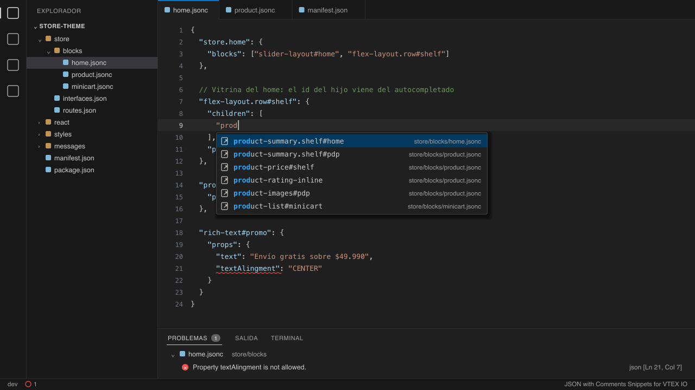

# VTEX IO Snippets

**Snippets, validación e IntelliSense para temas de VTEX IO Store Framework.**

Extensión de VS Code para quien construye temas de VTEX IO Store Framework: snippets de bloques y props con sus enums,
la validación de `store/blocks`, rutas y contentSchemas mientras escribes, la navegación entre los ids de bloque del
tema y el autocompletado de las variables CSS del VTEX Style.

[](https://marketplace.visualstudio.com/items?itemName=commenteme.vtex-io-intellisense)
[](https://marketplace.visualstudio.com/items?itemName=commenteme.vtex-io-intellisense)
[](./LICENSE)



Versión del código: **5.0.0**, según [package.json](package.json). Requiere **VS Code >= 1.60.0**. El identificador
publicado sigue siendo `commenteme.vtex-io-intellisense`, aunque el nombre visible sea VTEX IO Snippets. La
documentación detallada de cada función está en la [wiki](https://github.com/zeluizr/vtex-io-snippets/wiki).

---

## Por qué otra extensión

Todo lo que sugiere sale de un solo catálogo, [data/blocks.json](data/blocks.json), y nada de lo publicado se edita a
mano:

- **Un catálogo, todo generado**: los 385 snippets de bloques y el JSON Schema salen del mismo archivo, y la CI falla
  si lo commiteado no es exactamente lo que produce el generador.
- **Sugerencias según el lugar**: el bloque completo solo aparece en la raíz del archivo, los ids del tema dentro de
  `children` y `blocks`, y dentro de `props` solo las propiedades del bloque.
- **Navegación entre bloques**: Go to Definition, Find All References y Hover sobre los ids del tema.
- **Las variables CSS de tus tokens**, no de una lista fija: lee el mismo JSON que usa el VTEX Style.

## Instalación

Desde el VS Code Marketplace: busca **«VTEX IO Snippets»**, o desde Quick Open (`Cmd/Ctrl + P`):

```
ext install commenteme.vtex-io-intellisense
```

Desde el terminal:

```bash
code --install-extension commenteme.vtex-io-intellisense
```

## Uso

### Bloques y props

En los `.json` y `.jsonc` de `store/` (por ejemplo `store/blocks/*.jsonc`), escribe el nombre de un bloque para
insertar el snippet. Las props se autocompletan con sus enums y se validan contra el esquema de bloques
(`blocks.json`, `store/blocks/**/*.json`, `store/**/*.jsonc`).

| Dónde está el cursor | Qué sugiere |
| :--- | :--- |
| Raíz del archivo | El bloque completo, con sus props |
| `children`, `blocks`, `before`, `after`, `around` | Los ids de bloque ya definidos en el tema |
| `props` | Solo las propiedades del bloque, con sus enums |

### Variables CSS del VTEX Style

En los `css`, `scss`, `less` y `postcss`, al escribir `-` o `(` se autocompletan las CSS custom properties que VTEX
expone en runtime: `var(--emphasis)`, `var(--spacing-2)`, `var(--type-scale-1)`, `var(--background-action-primary)`...
Si el cursor ya está dentro de `var(`, inserta solo el nombre. Las de color muestran su muestra y el valor.

Los tokens se leen, en este orden, de `styles/configs/tokens.json`, de `tokens.json` en la raíz del workspace o, si no
hay ninguno, de un `tokens.json` incluido con los valores por defecto de VTEX. Los cambios se recargan solos, y un
JSON inválido no borra los tokens anteriores.

## Configuración

No tiene ajustes: las sugerencias dentro de strings y la validación de JSON se encienden solas en `json` y `jsonc`.

Desde la paleta de comandos (`Cmd/Ctrl + Shift + P`):

| Comando | Qué hace |
| :--- | :--- |
| `VTEX: Gerar tokens.css` | Exporta un `:root { ... }` con todas las variables, junto al JSON de origen |

## Junto con otras extensiones

No trae gramática ni tema: trabaja sobre los lenguajes `json`, `jsonc`, `css`, `scss`, `less` y `postcss` del propio
VS Code, y convive con cualquier extensión que los use.

## Solución de problemas

**No aparece ninguna sugerencia de bloque.** Solo se ofrecen en archivos bajo `store/`, y el bloque completo solo en
la raíz del archivo. Dentro de `props` es intencional: ahí solo caben propiedades.

**`Ctrl + Espacio` no abre las sugerencias (macOS).** macOS usa ese atajo para cambiar la fuente de entrada. Usa
`Cmd + I`, o libéralo en **Ajustes del Sistema → Teclado → Atajos de teclado → Fuentes de entrada**.

**Usaba el tema Puelche.** El tema de color, los iconos y los ajustes de confort salieron de esta extensión en la
5.0.0 y van a publicarse como una extensión aparte. Hasta entonces, VS Code vuelve a su tema y sus iconos por defecto.

## Estructura

```
.
├── extension.js       # activate()/deactivate(), providers y comandos
├── lib/               # lógica pura, sin la API vscode (testeable con node:test)
├── data/blocks.json   # catálogo de bloques del Store Framework (fuente de todo lo generado)
├── snippets/          # .code-snippets (generado desde data/blocks.json)
├── schemas/           # JSON Schema de los bloques (generado)
├── assets/tokens.json # tokens del VTEX Style por defecto
├── images/            # ícono (PNG y SVG) e imagen del README
├── scripts/           # generadores: schema, cobertura, ícono e imagen del README
└── test/              # node:test
```

## Desarrollo

JavaScript puro, sin TypeScript y sin build: el `main` es `extension.js`, tipado con JSDoc y `// @ts-check`. CommonJS,
2 espacios, sin punto y coma y con comillas simples. Sin dependencias de runtime.

```bash
git clone https://github.com/zeluizr/vtex-io-snippets.git
cd vtex-io-snippets
npm install

npm test                          # corre los tests
node scripts/generate-schema.js   # regenera schemas/ y snippets/ desde data/blocks.json
npm run icone                     # regenera images/icon.png desde images/icon.svg
npm run preview                   # regenera images/preview.png
npx --yes @vscode/vsce package --no-dependencies   # genera el .vsix
```

`F5` en VS Code abre una ventana de desarrollo con la extensión cargada.

**Lo generado nunca se edita a mano.** Los snippets y el JSON Schema salen de `data/blocks.json` con un generador
determinista, y la CI falla si lo commiteado no es exactamente lo que produce.

**Ramas y publicación.** El trabajo sale de `dev` y llega por pull request; `dev → qa → main` por merge de la rama
entera. Una tag `v*` en `main` empaqueta el `.vsix` y lo adjunta a la Release de GitHub. La publicación en el
Marketplace es manual, desde `main`, con `npx @vscode/vsce publish --no-dependencies`: sube la versión en
`package.json` y cierra el `CHANGELOG.md` antes, porque el Marketplace rechaza una versión repetida.

Conventional Commits; el mensaje describe el efecto, no el cambio.

## Licencia

MIT, ver [LICENSE](LICENSE).

---

_Hecho con amor y café por [commente.me](https://commente.me)_
