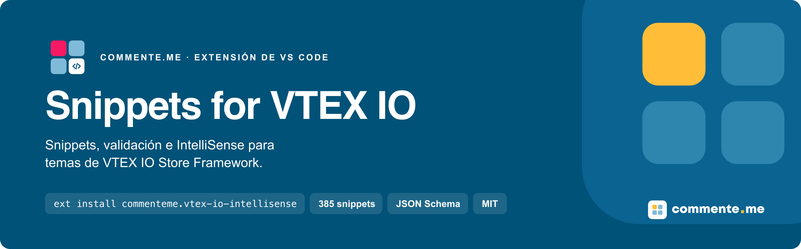

<p align="center">
  
</p>

# Snippets for VTEX IO

**Snippets, validación e IntelliSense para temas de VTEX IO Store Framework.**

[](https://marketplace.visualstudio.com/items?itemName=commenteme.vtex-io-intellisense)
[](https://marketplace.visualstudio.com/items?itemName=commenteme.vtex-io-intellisense)
[](./LICENSE)

## Instalación

En Quick Open de VS Code (`Cmd/Ctrl + P`):

```
ext install commenteme.vtex-io-intellisense
```

Desde el terminal, `code --install-extension commenteme.vtex-io-intellisense`. En el Marketplace aparece como
**«Snippets for VTEX IO»**. Requiere VS Code `>= 1.60.0`.

## Uso rápido

Abre un `store/blocks/*.jsonc` de tu tema y escribe el nombre de un bloque, por ejemplo `flex-layout.row`. El snippet
entra con sus props; dentro de `children` te sugiere los ids de bloque que ya existen en el tema.


## Que incluye

- **Snippets de bloques y props**: 385 bloques del Store Framework, con los enums de cada prop.
- **Validación mientras escribes**: `store/blocks`, rutas y contentSchemas contra un JSON Schema.
- **Navegación entre bloques**: Go to Definition, Find All References y Hover sobre los ids del tema.
- **Variables CSS del VTEX Style**: autocompletado de `var(--...)` con los tokens de tu tema.
- **Comando `VTEX: Gerar tokens.css`**: exporta un `:root { ... }` con todas las variables.

## Por que existe

Todo lo que sugiere sale de un solo catálogo, [data/blocks.json](data/blocks.json), y nada de lo publicado se edita a
mano: los snippets y el JSON Schema salen del mismo archivo, y la CI falla si lo commiteado no es exactamente lo que
produce el generador. Las sugerencias cambian según el lugar del cursor, y las variables CSS salen de tus tokens, no
de una lista fija.

## Documentación

La documentación detallada de cada función está en la [wiki](https://github.com/zeluizr/vtex-io-snippets/wiki). El
identificador publicado sigue siendo `commenteme.vtex-io-intellisense`, aunque el nombre visible sea Snippets for
VTEX IO.

### Bloques y props

En los `.json` y `.jsonc` de `store/`, las props se autocompletan con sus enums y se validan contra el esquema de
bloques (`blocks.json`, `store/blocks/**/*.json`, `store/**/*.jsonc`).

| Donde está el cursor | Que sugiere |
| :--- | :--- |
| Raíz del archivo | El bloque completo, con sus props |
| `children`, `blocks`, `before`, `after`, `around` | Los ids de bloque ya definidos en el tema |
| `props` | Solo las propiedades del bloque, con sus enums |

### Variables CSS del VTEX Style

En los `css`, `scss`, `less` y `postcss`, al escribir `-` o `(` se autocompletan las CSS custom properties que VTEX
expone en runtime: `var(--emphasis)`, `var(--spacing-2)`, `var(--type-scale-1)`, `var(--background-action-primary)`...
Si el cursor ya está dentro de `var(`, inserta solo el nombre. Las de color muestran su muestra y el valor.

Los tokens se leen, en este orden, de `styles/configs/tokens.json`, de `tokens.json` en la raíz del workspace o, si no
hay ninguno, de un `tokens.json` incluido con los valores por defecto de VTEX. Los cambios se recargan solos, y un
JSON inválido no borra los tokens anteriores.

### Configuración

No tiene ajustes: las sugerencias dentro de strings y la validación de JSON se encienden solas en `json` y `jsonc`.

Desde la paleta de comandos (`Cmd/Ctrl + Shift + P`):

| Comando | Que hace |
| :--- | :--- |
| `VTEX: Gerar tokens.css` | Exporta un `:root { ... }` con todas las variables, junto al JSON de origen |

No trae gramática ni tema: trabaja sobre los lenguajes `json`, `jsonc`, `css`, `scss`, `less` y `postcss` del propio
VS Code, y convive con cualquier extensión que los use.

### Solución de problemas

**No aparece ninguna sugerencia de bloque.** Solo se ofrecen en archivos bajo `store/`, y el bloque completo solo en
la raíz del archivo. Dentro de `props` es intencional: ahí solo caben propiedades.

**`Ctrl + Espacio` no abre las sugerencias (macOS).** macOS usa ese atajo para cambiar la fuente de entrada. Usa
`Cmd + I`, o libéralo en **Ajustes del Sistema → Teclado → Atajos de teclado → Fuentes de entrada**.

**Usaba el tema Puelche.** El tema de color, los iconos y los ajustes de confort salieron de esta extensión en la
5.0.0 y van a publicarse como una extensión aparte. Hasta entonces, VS Code vuelve a su tema y sus iconos por defecto.

### Estructura

```
.
├── extension.js       # activate()/deactivate(), providers y comandos
├── lib/               # lógica pura, sin la API vscode (testeable con node:test)
├── data/blocks.json   # catálogo de bloques del Store Framework (fuente de todo lo generado)
├── snippets/          # .code-snippets (generado desde data/blocks.json)
├── schemas/           # JSON Schema de los bloques (generado)
├── assets/            # tokens.json del VTEX Style por defecto y header del README
├── images/            # ícono (PNG y SVG) e imagen del README
├── scripts/           # generadores: schema, cobertura, ícono e imagen del README
└── test/              # node:test
```

### Desarrollo

JavaScript puro, sin TypeScript y sin build: el `main` es `extension.js`, tipado con JSDoc y `// @ts-check`. CommonJS,
2 espacios, sin punto y coma y con comillas simples. Sin dependencias de runtime.

```bash
git clone https://github.com/zeluizr/vtex-io-snippets.git
cd vtex-io-snippets
npm install

npm test                          # corre los tests
node scripts/generate-schema.js   # regenera schemas/ y snippets/ desde data/blocks.json
npm run icone                     # regenera images/icon.png desde images/icon.svg
npm run preview                   # regenera images/preview.png
npx --yes @vscode/vsce package --no-dependencies   # genera el .vsix
```

`F5` en VS Code abre una ventana de desarrollo con la extensión cargada.

**Lo generado nunca se edita a mano.** Los snippets y el JSON Schema salen de `data/blocks.json` con un generador
determinista, y la CI falla si lo commiteado no es exactamente lo que produce.

**Ramas y publicación.** El trabajo sale de `dev` y llega por pull request; `dev → qa → main` por merge de la rama
entera. Una tag `v*` en `main` empaqueta el `.vsix` y lo adjunta a la Release de GitHub. La publicación en el
Marketplace es manual, desde `main`, con `npx @vscode/vsce publish --no-dependencies`: sube la versión en
`package.json` y cierra el `CHANGELOG.md` antes, porque el Marketplace rechaza una versión repetida.

## Contribuir · Licencia

Conventional Commits, rama desde `dev` y PR contra `dev`; mira [CONTRIBUTING.md](CONTRIBUTING.md).
[MIT](./LICENSE).

---

Hecho por [commente.me](https://commente.me) · hola@commente.me
